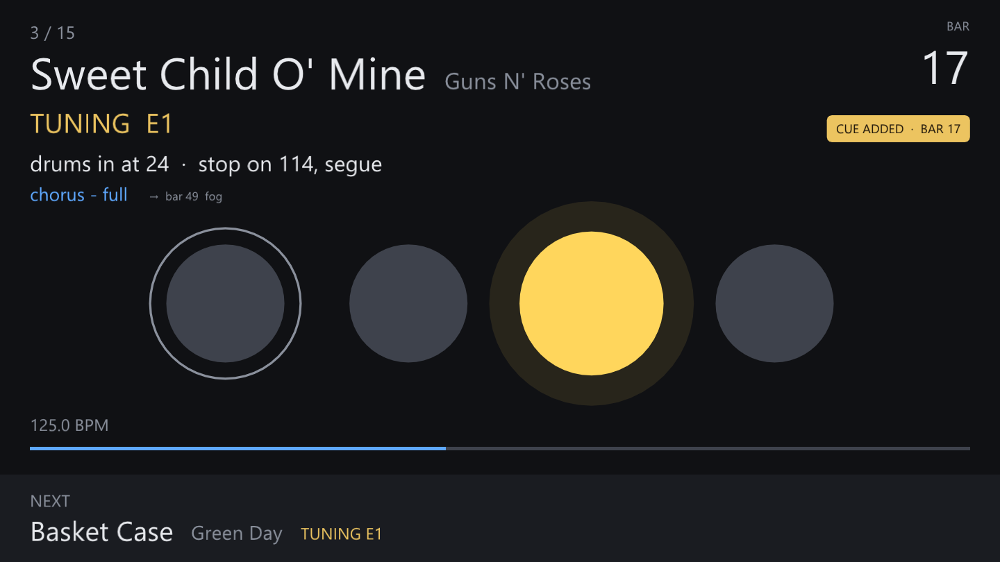
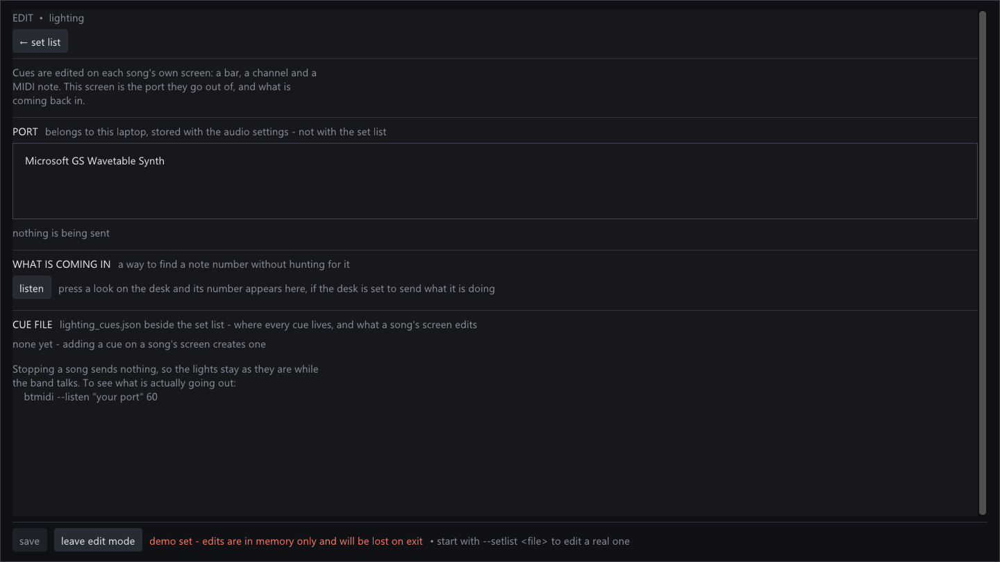

# Lighting

BackingTrackLive sends MIDI notes. QLC+ owns the fixtures, the looks and the
DMX, and a separate project owns the show design and generates the cue file
this reads.

The split is deliberate, and it is now a written contract:
`docs/lighting-contract.md`, format `random-riot-lighting/2` - and `/1`,
which is still read. Neither side changes it alone.

## What this program knows

Almost nothing. It knows where the playhead is in bars, and it knows that when
the playhead reaches a bar listed in the cue file it should send the note the
file gives for that bar. It does not know what any look is, what colours
exist, how many fixtures there are, or anything about QLC+.

That is why adding songs or changing colours needs no change here at all: it
is a rebuild on the lighting side and a new `lighting_cues.json`. Moving a cue
to a different bar is the one thing this program does edit - see below.

## What goes down the wire

One note on and its note off, per event:

```
Note On   0x90 | (ch-1)   note   velocity
Note Off  0x80 | (ch-1)   note   0
```

No program changes, no controllers, no clock, no "next". **Every event is
absolute** - "show look number N" - which is the property that makes the rest
simple. There is no cue list position to stay in step with, so a song that is
skipped, restarted or scrubbed cannot leave the lights out of step, and there
is nothing to resync.

## The rules it follows

**Bar 1 is the downbeat after the count-in.** By default the count-in sends
nothing and the between-songs look stays up while the band hears the click.

**A cue can sit in the count-in, if you ask for one.** Bar 0 is the last
count-in bar, bar -1 the one before it, and so on backwards - which is enough
for a build into the downbeat, the thing a count-in is otherwise wasted on. A
cue needs the count-in to actually reach it: bar 0 needs one count-in bar, bar
-1 needs two. Ask for a bar earlier than the song counts in for and the editor
says so, because the cue would simply never fire and nothing on stage would
tell you.

This is the one difference between `random-riot-lighting/1` and `/2`. A show
with no count-in cue is still written as `/1`, so the lighting side's
generator keeps reading it; the tag moves to `/2` only for a file that needs
it. Both are read.

**Cues are kept in bar order**, which is also the order the contract says the
file is in. A cue added late sorts into place when you finish typing its bar -
when you tab away or press Enter, not while you type, or the row would walk
across the table as "117" arrives as 1, then 11, then 117. The row you are
working on stays highlighted so you can see where it went.

**Copying a song copies its cues.** Cues are matched to a song by title and a
copy has to take a new title, so without this the copy would come up dark.

**Renaming a song renames its cues**, for the same reason and more urgently:
title is the only key the cue file has, so a retitled song would otherwise be
matched to nothing and the editor's lighting section would empty as you
typed. The entry is renamed when you finish typing the title, not per
keystroke. If cues already exist under the new title they are left alone and
the song matches those instead - the editor says so, and the old ones are
still in the file under the old name.

Renaming the entry is deliberately not the same as giving each song an id.
The cue file is written by the lighting side as well, from song titles; an id
would have to be agreed, generated and kept in step over there too, and a
file with two keys has two ways to disagree with the set list instead of one.
What this does mean is that **a song renamed here has to be renamed on the
lighting side as well** before the show is next generated, or the generator
will write the old title back in as a second entry.

**The look showing has its name on the play screen**, under the song and the
band's own note, with the bar of the next change beside it. That is the
`label` from the cue file - §3 calls it UI-only and this is the UI it is for.
It is worked out from the playhead every frame rather than remembered from
whatever was last sent, so it is right after a jump, right with no MIDI port
open at all, and cannot drift out of step with the stage. A song the cue file
does not name shows nothing at all.

Hits and ends do not take the line over: fog at bar 49 does not mean the band
left the chorus, and the between-songs note at the end of a song is not a
section. The name is the last *look*, which is the same question seeking asks.

## Tapping cues in by ear

Two things have to come from outside this program: which MIDI note a look is,
which is on the desk, and which bar it changes on, which is in the song. The
lighting screen has a way at each.

For the bar: tick **Q adds a cue at the current bar** on the lighting screen,
play the song, and press `Q` every time the lights should change. Each press
writes a cue at the bar the playhead is in - the bar you are *in*, rounded
down, because a person presses this having heard the change, a moment after
the downbeat. Nothing is sent; pressing `Q` cannot alter what the stage is
doing, which is what makes it safe to press during a song. When the song
stops, the taps are saved.

Because nothing is sent, the screen is the only confirmation there can be, so
for a bar or two after each press it says what was written down and at which
bar - under the bar number, which is what you are watching anyway.



Every tapped cue arrives on channel 16, note 37 - the between-songs note -
labelled `Added by hotkey q` so it is obvious in the table which still need
real values. **That note is a real one**: play the song again before giving
them their own notes and the first tapped bar will throw the stage to the
between-songs look. These are scaffolding, meant to be filled in before the
song is played for anyone.

Arming is **off every time the program starts** and is not stored anywhere.
The two mistakes are not equal: forgetting to arm it costs a run-through at
rehearsal, and forgetting to disarm it puts junk into the show at a gig.

**Seeking asks one question: what should the stage look like here.** The most
recent *look* at or before the playhead is sent, and nothing else. Hits -
blinders, fog - that were missed stay missed, because a blast of fog owed from
four minutes ago is not a debt worth paying. An end is not a look either, so
scrubbing back into a song does not leave the between-songs state up.

**A look that is already showing is not sent again.** QLC+'s buttons toggle,
so re-sending would switch the look off. What is showing is tracked as a
channel and a note together, since note 37 on channel 16 and note 37 on
channel 1 are different buttons.

**Stopping sends nothing.** Not a blackout, not the between-songs look,
nothing. The band may still be playing the song live, and stale light beats a
surprise every time. The between-songs look arrives from the song's own end
event, or because somebody pressed the button for it.

**`B`, on the play screen, is that button.** It sends `specials.between_songs`
from the cue file - §6 of the contract, which is where that note is defined,
because this program does not know what it means any more than it knows what
any other note means. It is the bail-out: the band has come apart from the
click, somebody presses space to stop it, the lights hold whatever the song
left up, and `B` puts them back to the between-songs look without anyone
going to the laptop. Pressing it when that look is *already* up toggles it
off instead, which is a blackout - the other thing a hand reaches for at that
moment, and the reason this one key covers both.

It is never suppressed, unlike a repeated look: being asked for twice on
purpose is the whole point. The footer offers the key only when the cue file
defines the special, since a key that does nothing is worse than no key, and
`edit -> lighting` has buttons for the same thing plus `stop_all`.

**Cues are sent from the UI thread, driven by the sample counter** - never
from a wall clock, and never from the audio callback, where a syscall would
cost a dropout. That puts them within about 16 ms of the bar.

## Setting it up

1. **loopMIDI**: a port named as the cue file asks - `BackTrackQLC` today. Set
   it to start with Windows; a port that vanished is the most boring possible
   reason for a dark stage.
2. **The cue file**: copy `lighting_cues.json` into the set list folder, beside
   `setlist.json`. It is read from there, so a set list folder carried to the
   backup laptop takes its lighting with it.
3. **QLC+**: open the same port as an input, and open the show.
4. **Edit mode -> lighting** confirms what loaded, which songs matched, and
   which port is open.

Song titles are matched **exactly** between `setlist.json` and
`lighting_cues.json`. The lighting screen says how many matched and names the
ones that did not, because a title that drifted by one character is otherwise
silent.

## Editing cues

Cues live in `lighting_cues.json` beside the set list, and that is where they
are edited - the same way a song's tempo lives in `setlist.json` and is edited
there. One file, one source of truth, nothing to reconcile.

**Edit mode -> a song.** The cues are listed and can be changed; `+ cue` adds
one. Saving the song saves the cue file too, because they are edited together
and one without the other is a set that does not light right.

| | |
|---|---|
| **bar** | 1 is the first downbeat; 0 and below are in the count-in |
| **channel** | 1-16, whatever the desk is listening on |
| **MIDI note** | 0-127, whichever one the desk has bound to that look |
| **what it is** | never sent, but shown on stage while that look is up |
| **on a rewind** | whether dropping into the middle of the song puts this back |

"What it is" is the only one of the four that is purely yours. It goes
nowhere near the wire - and it is on the play screen for as long as that look
is up, so it is worth writing what you would want to read from across a
stage. "Chorus 1" beats "cue 4".

The channel and the note are **looked up on the lighting desk**. This program
has no idea what any note means and no way to find out: that mapping exists
only in QLC+. Find the number once, type it in, and it goes out at that bar
for ever after.

"On a rewind" is the only question beyond the three numbers, and it matters
just when scrubbing in rehearsal. A lighting state should be put back when you
drop into the middle of a song; a blast of fog should not go off again.



**Edit mode -> lighting** has a `listen` button which shows any note arriving
on the port. If the desk reports what it is doing, pressing a look there shows
its number and saves the hunt.

### If the show is generated

The common case is that something else writes `lighting_cues.json` - a script,
or a session that reads the QLC+ workspace. That still works: it owns what the
looks are, and BackingTrackLive only ever changes *when* they fire.

The thing to be careful of is the other direction. **Regenerating the file can
overwrite a bar the band settled on at rehearsal**, because nothing in the file
says which bars were hand-adjusted. The generator is the side that can fix
that, by keeping the existing bar for any cue that is still there and taking
the generated bar only for new ones. `docs/lighting-contract.md` says so in
§9.

### If there is no cue file yet

Adding a cue creates one. A set list with no lighting at all can be given cues
entirely from the editor; the port then comes from the audio settings rather
than from the file.

## Proving it without a rig

**QLC+ runs a show with no fixtures patched.** Its Virtual Console shows a
button per cue and lights the active one, so a whole set can be watched
on screen in time with the music.

**Watch the wire** when something disagrees:

```
btmidi --list
btmidi --listen "BackTrackQLC" 60
```

Cues appear there but nothing happens in QLC+ - it is the QLC+ side. Nothing
appears - it is this side. That one question is most of the debugging, and a
dark room with a band waiting is no place to work it out.

## If there are no lights

No `lighting_cues.json` in the set list folder means no lighting, one line on
the lighting screen, and everything else works exactly as before. A cue file
in a format this does not implement is refused outright rather than guessed
at: a show built against a different contract would send the wrong notes at
the wrong bars, which is worse than sending none.
